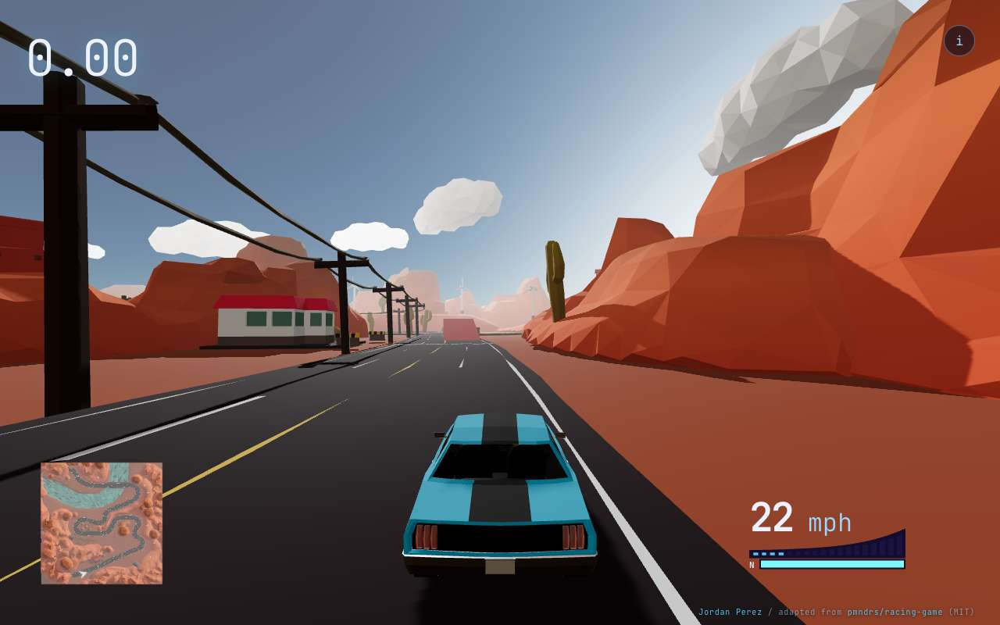

Adapted from pmndrs/racing-game (MIT) by Jordan Perez

# JP Racing



Live: https://jewgah.github.io/jp-racing/

A browser driving game built from React components with React Three Fiber and cannon physics. This fork takes the original [pmndrs/racing-game](https://github.com/pmndrs/racing-game) (last commit February 2023, on React 18, R3F 8, drei 9, three r139 and Vite 2), brings it onto the current stack and rebrands it.

## What changed in this fork

- **Stack upgrade**: React 19, React Three Fiber 9, drei 10, three r187, zustand 5, Vite 8, TypeScript 7. The upstream yarn/husky/eslint setup was replaced by npm and a plain `tsc && vite build`.
- **@react-three/cannon kept** (6.6.0): its last release dates from 2023, but it runs on R3F 9 with no console errors, and the car behaves the same as upstream (speed curve checked side by side), so swapping the physics engine would have been all risk for no gain.
- **three.js migration fixes**: `BoxBufferGeometry` removed, physically correct lights retuned, PCF soft shadows replaced, GLTF typings, and two particle bugs caused by newer three: instanced meshes now start as identity (unused particles rendered as big spheres) and `Matrix4.decompose` reports scale 1 for a zero matrix (dead dust particles respawned at full size).
- **Rebrand**: new start screen, HUD, gauges, popups and fonts in the jordanperez.dev palette (#050310 space, #4cc9f0 cyan), title "JP Racing".
- **Local leaderboard**: the hosted Supabase leaderboard and GitHub login (with a public key in the source) were removed. Best laps are now saved in `localStorage`, with a driver name, a "new best" flag, your rank, and a best laps panel (press L).
- **Touch controls**: on phones and tablets, on-screen pads for steering, gas, reverse, drift and boost, plus reset and camera buttons, and a compact HUD layout.
- **Pages deploy**: GitHub Actions builds and publishes to GitHub Pages (`base: '/jp-racing/'`, all asset paths made relative).
- A small in-app credit links back to the original project.

## Run it

```bash
npm install
npm run dev
```

## Controls

Arrows or WASD to drive, Space to drift, Shift to boost, R to reset, C for camera, L for best laps, M for the map, P for car color, U to mute, I for help, `.` for the editor.

## Credits and license

Original game by Poimandres and the racing-game contributors, MIT licensed, see [LICENSE.md](LICENSE.md). Assets are CC0 as in upstream. Fork changes by [Jordan Perez](https://jordanperez.dev).
